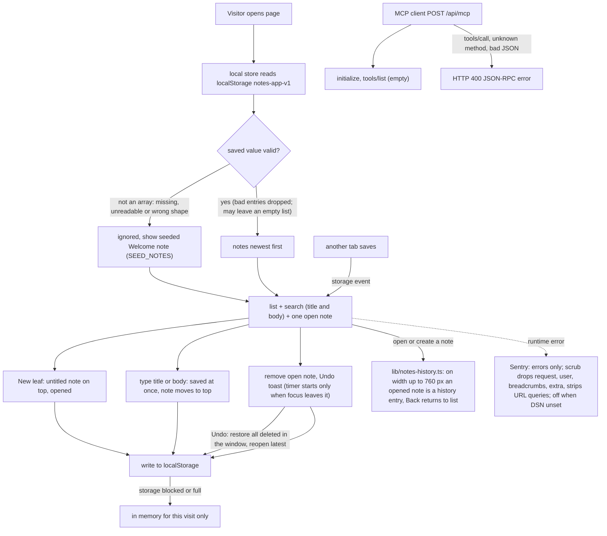

# 01 — Business process (As-Is / To-Be)

Field Notebook คือสมุดโน้ตข้อความล้วนที่ทำงานในเบราว์เซอร์ (Next.js) สร้างโน้ตใหม่ เขียน ค้นหา และลบ โดยเรียงใหม่สุดก่อนและเก็บใน localStorage เท่านั้น `/api/mcp` ไม่มีเครื่องมือ (tools/list ว่าง และ tools/call ถูกปฏิเสธ) เพราะโน้ตไม่ออกจากเบราว์เซอร์ (ยกเว้นรายงานข้อผิดพลาดไป Sentry ตามที่ scrub อนุญาต)

Last reviewed: 2026-11-28 · commit `47e24f5`

## As-Is (จากโค้ดวันนี้)

Sources: `app/page.tsx`, `lib/notes.ts`, `lib/local-store.ts`, `lib/notes-history.ts`, `app/api/mcp/route.ts`, `lib/sentry.ts`, `README.md`, `PRODUCT.md`

ข้อเท็จจริงสำคัญจากโค้ด:

- ไม่มี markdown, tag, pin, export หรือ sync (`README.md` §What it does not do)
- ความเสี่ยงเรื่อง history บนมือถือระบุไว้ใน `PRODUCT.md` §Known limits (ยอมรับแล้ว)
- CI (GitHub Actions บน push/PR) แยกจากการ deploy: ไม่มี workflow ที่ deploy
- การ deploy: Vercel Git link ของโปรเจกต์ `bookchaowalit-notes-app-frontend` ชี้ repo นี้ branch production `main` (ตรวจผ่าน Vercel API 2026-11-28) push ไป `main` จึง deploy (ไม่ผ่าน CI gate); production = `47e24f5` ส่วน main HEAD `0ed7728` ล้ำหน้าเฉพาะ commit ใน `docs/`

## To-Be (ไม่มีแหล่งที่เขียนไว้)

ไม่มี To-Be ที่เขียนไว้

## Gap

| ID | As-Is → To-Be | Status | Owner | Evidence |
|---|---|---|---|---|
| G1 | Vercel Git ผูกกับ repo เก่า ผลิตจริงถูก deploy ด้วย CLI เท่านั้น (push main ไม่ deploy) → Vercel Git ผูกกับ repo นี้ เพื่อให้ push main = deploy | done | owner | `PRODUCT.md` §Live URL and deploy state (owner action D9); Vercel API 2026-11-28: project `bookchaowalit-notes-app-frontend` Git link → `bookchaowalit-website/productivity-notes-app-web`, production branch `main` |
| G2 | ไม่มี To-Be ของกระบวนการเขียนไว้ → owner กำหนดเป้าหมาย (ฟีเจอร์/ขอบเขตถัดไป) หรือยืนยันว่า As-Is คือเป้าหมายสุดท้าย | decide | owner | ไม่มีใน `PRODUCT.md` / `README.md` / `specs/` |
