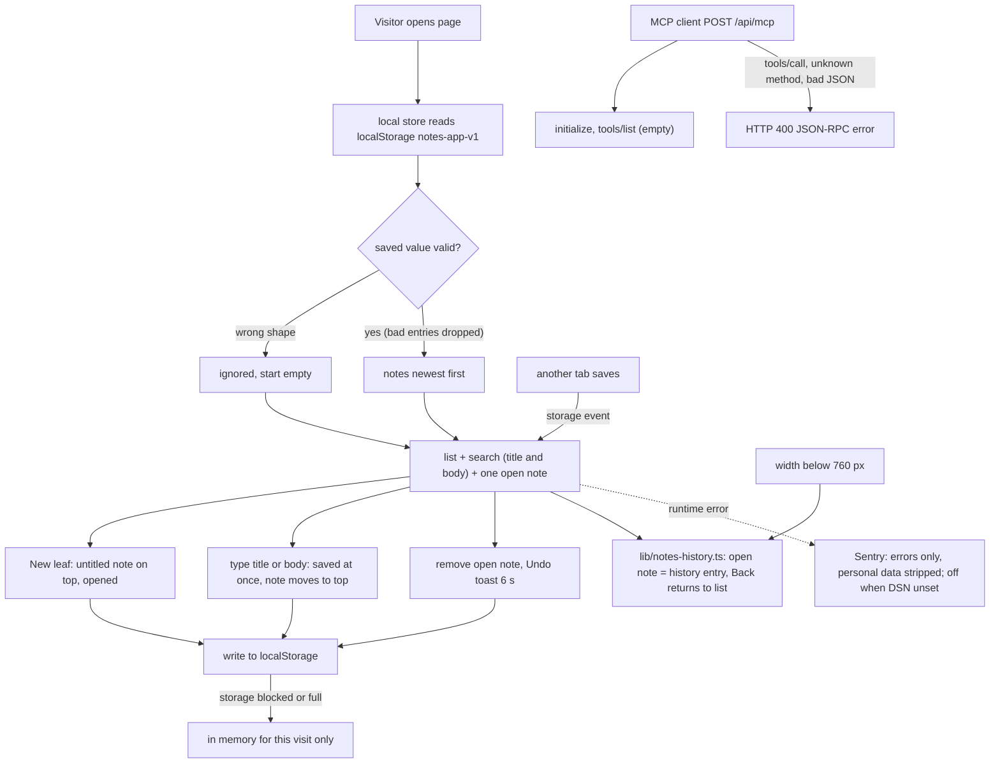

# 01 — Business process (As-Is / To-Be)

Field Notebook คือสมุดโน้ตข้อความล้วนที่ทำงานในเบราว์เซอร์ (Next.js) สร้างโน้ตใหม่ เขียน ค้นหา และลบ โดยเรียงใหม่สุดก่อนและเก็บใน localStorage เท่านั้น `/api/mcp` ไม่มีเครื่องมือ (tools/list ว่าง และ tools/call ถูกปฏิเสธ) เพราะโน้ตไม่ออกจากเบราว์เซอร์

Last reviewed: 2026-11-28 · commit `47e24f5`

## As-Is (จากโค้ดวันนี้)

Sources: `app/page.tsx`, `lib/notes.ts`, `lib/local-store.ts`, `lib/notes-history.ts`, `app/api/mcp/route.ts`, `lib/sentry.ts`, `README.md`, `PRODUCT.md`

ข้อเท็จจริงสำคัญจากโค้ด:

- ไม่มี markdown, tag, pin, export หรือ sync (`README.md` §What it does not do)
- ความเสี่ยงเรื่อง history บนมือถือระบุไว้ใน `PRODUCT.md` §Known limits (ยอมรับแล้ว)
- การ deploy: Vercel CLI ตาม `PRODUCT.md`; push ไป `main` ไม่ deploy ถ้า Git ยังผูก repo เก่า [ต้องยืนยัน]

## To-Be (ไม่มีแหล่งที่เขียนไว้)

ไม่มี To-Be ที่เขียนไว้

## Gap

| ID | As-Is → To-Be | Status | Owner | Evidence |
|---|---|---|---|---|
| G1 | Vercel Git ผูกกับ repo เก่า ผลิตจริงถูก deploy ด้วย CLI เท่านั้น (push main ไม่ deploy) → Vercel Git ผูกกับ repo นี้ เพื่อให้ push main = deploy | decide | owner | `PRODUCT.md` §Live URL and deploy state (owner action D9) [ต้องยืนยัน: สถานะวันนี้ต้องเช็กใน Vercel] |
| G2 | ไม่มี To-Be ของกระบวนการเขียนไว้ → owner กำหนดเป้าหมาย (ฟีเจอร์/ขอบเขตถัดไป) หรือยืนยันว่า As-Is คือเป้าหมายสุดท้าย | decide | owner | ไม่มีใน `PRODUCT.md` / `README.md` / `specs/` |
